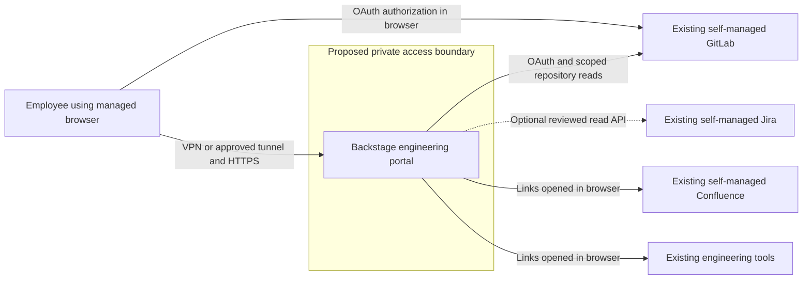
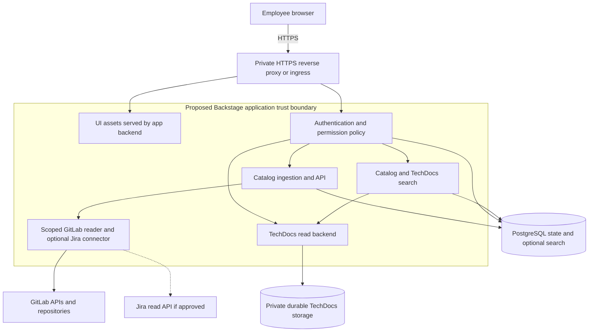
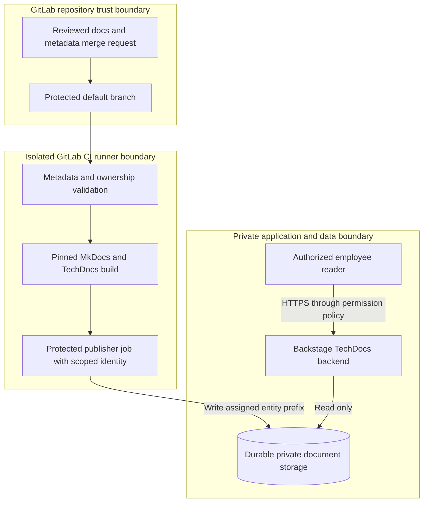

# Backstage: Architecture proposal (RFC-001)

[Overview](README.md) · [Terms](../../../CONTEXT.md)

## 1. Purpose and approval

This proposal starts the Backstage adoption process for service ownership, GitLab metadata and TechDocs.
InfraOps needs explicit OpSec approval before allocating production resources. InfraOps owns the final design and may adapt these options.
The architecture is a starting point, not the final implementation design. Production approval and provisioning remain pending.

Proposed Design: one containerized application, PostgreSQL, and durable private documentation storage.
GitLab CI builds and publishes TechDocs. GitLab OAuth is the candidate sign-in method.
Start with Jira, Confluence and operational-tool links.

Still to define: hosting, identity authority, storage, secret service, content audience and operational ownership.
InfraOps selects hosting and coordinates connectivity with NetworkOps as needed.

## 2. Problem, benefits and constraints

Engineers need to find service owners, dependencies and documentation quickly.
Backstage can combine this information while teams retain source ownership in GitLab.
The pilot must measure whether this reduces search and handover work.

Organization context: self-managed GitLab, Jira and Confluence; Proxmox; on-premises/VPS capacity; private VPNs/tunnels; Helm, ArgoCD and Ansible/AWX practices.
No suitable cluster, database, storage, ingress, identity provider or secret service has been confirmed.
Plan for approximately 200 employees with periodic access and over 200 services with TechDocs.

## 3. Scope and exclusions

Include the Software Catalog, team ownership, TechDocs, read-only GitLab integration, limited discovery and approved tool links.
Keep catalog metadata and documentation in each service repository. Use normal merge requests for changes.

Defer software templates, provisioning actions, infrastructure controls and write-capable integrations.
Install only the modules required for the initial scope. Keep deferred capabilities disabled and omit their credentials.
Backstage supports incident work with service context. Monitoring, observability and AWX/Ansible handle detection and response outside Backstage.
The intended service remains available at all times; the uptime target and support coverage need InfraOps agreement.

## 4. PoC assessment and production basis

OpSec requested a small PoC for experiments and checks.
The requester will upload it to self-managed GitLab and add the repository link here.

**GitLab PoC repository: link pending upload.**

OpSec uses that repository to assess the application and report findings.
The PoC is assessment material, not an approved production design.
After explicit production approval, InfraOps prepares a new installation from the official open-source Backstage project.
This proposal selects no release, package versions or runtime toolchain.
InfraOps selects a supported release at implementation time and follows its official installation and deployment guidance.

InfraOps must assess authentication, permissions, plugins, integrations, persistence, networking and recovery for that new installation.
Configuration, connectors and compatibility remain implementation choices to validate after approval.
Use [Official references](official-source-notes.md) for the upstream guidance and required compatibility checks.

## 5. Proposed architecture

The diagrams use C4-style system/component boundaries. All production nodes and flows are proposed.
External systems come from the supplied organization context; their available interfaces remain unverified.

### System context

Tool links open in the user's browser. Each target system retains its own access controls.

### Logical components

These components initially share one backend process. Plugins are not security sandboxes.
Consider PostgreSQL-backed search for the selected release. Add a separate search/cache service only when justified.
Replicas must share persistent state. [Scaling guidance](https://backstage.io/docs/deployment/scaling/)

## 6. Hosting options

| Option                 | Security/network                                             | Cost and operations                                          | Availability                                                    | Selection condition                                 |
| ---------------------- | ------------------------------------------------------------ | ------------------------------------------------------------ | --------------------------------------------------------------- | --------------------------------------------------- |
| Existing Kubernetes    | Private ingress and enforced network policies                | Low added effort only if platform services/support exist     | Replicas help only with resilient ingress, database and storage | Confirm capacity, ownership and Helm/ArgoCD support |
| Dedicated Proxmox VM   | Private segment, host firewall and restricted administration | Simple pilot; OS/runtime/proxy maintenance remains necessary | One VM is one failure domain                                    | Use if no suitable cluster exists                   |
| VPS                    | Private access/tunnel; provider and data-location approval   | Rental, backup, transfer and tunnel support costs            | Provider/tunnel failure can isolate dependencies                | Require a clear benefit and measured connectivity   |
| Hybrid VPS/on-premises | More trust boundaries and encrypted site paths               | Reuses internal state; adds latency and coordination         | Tunnel remains a shared dependency                              | Accept only after latency/failure tests             |

Prefer supported existing infrastructure. Evidence does not support one unconditional hosting choice.
See [InfraOps requirements](infrastructure-requirements.md) for sizes, cost inputs and recovery options.

## 7. Identity and integrations

**Human authentication:** evaluate a team-owned GitLab OAuth application with an exact HTTPS callback and minimum tested scopes.
Confirm GitLab is the correct employee identity authority. Existing corporate OIDC or an approved proxy are alternatives.
Map each host/user ID to one trusted catalog User. Reject unknown or ambiguous identities.
Only trusted sources may define User/Group membership. Test suspension, renames, nested groups and active-session revocation.
Proposed removal target: 30 minutes, subject to OpSec approval and proof. [GitLab provider](https://backstage.io/docs/auth/gitlab/provider/)

**Repository access:** use separate non-human credentials restricted to approved groups/projects.
Compare group/project access tokens with a service account. Confirm version, licensing, API scopes and provider credential selection.
Do not grant writes or instance administration to simplify discovery.
After approval, select compatible discovery and organization modules from the upstream guidance. Validate them against the chosen release.
Start with scheduled discovery, proposed every 15 minutes. InfraOps assesses network implications before adding webhooks.
[GitLab discovery](https://backstage.io/docs/integrations/gitlab/discovery/)

**Metadata:** Platform supplies a versioned CI template for schema, unique names, real owners, approved links and documentation references.
Authorized InfraOps, NetworkOps and OpSec admins may manage the full catalog.
Designated domain leads may add only their own domain entries if those rights are practical to enforce.
Otherwise, catalog administration stays with InfraOps and its designated supporting admins.
Admins authorize the project-to-entity, owning-team and publication-prefix mapping. Metadata alone does not establish that authority.
Domain teams use reviewed merge requests. Confirm protected-branch/CODEOWNERS enforcement.
InfraOps coordinates stale/deleted entities and removal of copied docs/search content with domain leads.

**Jira:** start with links. Before API use, confirm the Data Center version and select a compatible maintained plugin/connector.
Test authentication, pagination, project permissions and issue security.
A service account must not expose content beyond the approved audience.
**Confluence:** links only; no backend token or content ingestion.

## 8. TechDocs and data ownership

Build TechDocs in GitLab CI and publish protected-branch output to durable storage. The backend reads that output.
Separate read and publication credentials. Scope each publisher to its assigned entity prefix.
Retain the last successful artifact. Test interrupted publication, concurrent jobs, rollback and deletion.
[TechDocs CI guidance](https://backstage.io/docs/features/techdocs/configuring-ci-cd/)

Prefer an existing private store. S3-compatible storage, including MinIO, is a candidate after compatibility tests.
Validate the selected Backstage publisher and CI tools against the chosen storage service. Do not assume S3 interoperability.
A supported, backed-up shared filesystem is an alternative. [Upstream storage guidance](official-source-notes.md)

Domain teams own source documents and classification. OpSec sets readership and publication rules. InfraOps implements controls and recovery.
The preferred policy is broad internal readership, including documents from repositories a reader cannot access.
OpSec decides the permitted audience and exceptions. Broad access does not mean public or anonymous access.
Source permissions and publication permissions are separate. TechDocs contains only material intended for Backstage.
Domain teams keep other material outside TechDocs sources and verify generated output before publication.
InfraOps chooses content-withdrawal and recovery controls within OpSec policy.

## 9. Operational responsibilities

| Owner                      | Responsibility                                                                                                                |
| -------------------------- | ----------------------------------------------------------------------------------------------------------------------------- |
| Platform Engineering       | Application expertise, plugin/CI support and metadata validation; operational assignment follows InfraOps design              |
| Domain teams               | Metadata, source docs, classification, reviews and decommission requests                                                      |
| NetworkOps                 | Network expertise and execution as coordinated by InfraOps; no separate proposal approval gate                                |
| OpSec/identity admins      | Identity authority, audience, credentials, access tests and risk acceptance                                                   |
| InfraOps                   | Final design, hosting, runtime, operational readiness, catalog administration, data services, recovery and service monitoring |
| GitLab/Jira administrators | Server versions, scoped identities and integration permissions                                                                |
| Engineering sponsor        | Business priorities and proposed outcome measures                                                                             |

Assignments remain proposed. Name one accountable person and deputy for each service and credential before provisioning.

## 10. Main risks and unknowns

The main risks are copied-content disclosure, incorrect identity mapping, stolen source tokens and compromised plugins/runtime.
Other risks include tunnel outages, lost state and insufficient maintenance support.
Hosting capacity, storage compatibility, secret handling, service targets and ownership remain unresolved.
OpSec will assess security through the [GitLab PoC](#4-poc-assessment-and-production-basis).
Use [Network requirements](network-review.md) for proposed flows and InfraOps planning.

## 11. Pilot and expansion criteria

Proposed pilot: 20–30 users, 10–20 services across 2–3 teams, four weeks after technical acceptance.
These limits and measures are planning proposals. InfraOps adjusts the rollout within OpSec-approved constraints.

- Give every entity a real owner, source link and classification.
- Pass allowed/denied identity, API, document, search and mutation tests.
- Meet the approved access-removal target. Measure catalog, document and search freshness against InfraOps-defined clocks and targets.
- Pass publication-failure, restore and representative load tests.
- Repeat five ownership/document tasks with at least ten users. Target 80% success and median completion below two minutes.
- Record broken/stale content, support requests and maintenance effort.

Test the pilot at its actual size. Before expansion, test at least 250 representative services/sites and confirm support capacity.
Review outcomes and remaining risks before rollout to approximately 200 employees or adding restricted content.
Privileged automation needs a separate approved proposal.

## 12. Next steps

Add the GitLab PoC link, then let OpSec run its experiments and checks.
OpSec findings define the boundaries for production approval and InfraOps delivery.
InfraOps owns deployment choices, resources and operational readiness. NetworkOps provides network expertise as InfraOps requires.
Implementation tests follow resource allocation; complete the required checks before granting user access or publishing internal content.
InfraOps may revise this proposal within OpSec-approved boundaries. It must not cross those boundaries.
A change beyond them requires OpSec to revise its approval before InfraOps proceeds.
