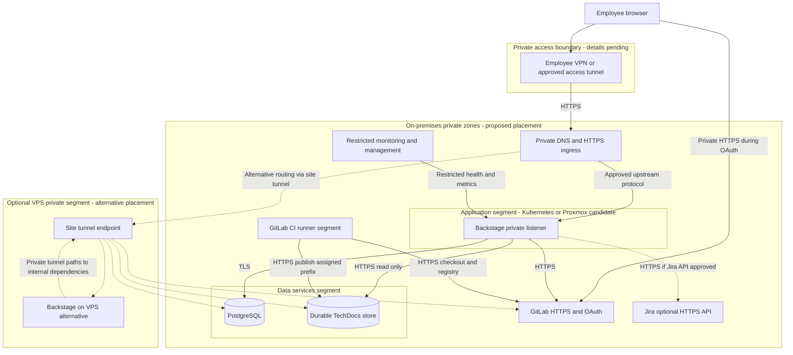

# Backstage: Network requirements

[Overview](README.md) · [Terms](../../../CONTEXT.md)

**Status: Proposed. Review date: 2026-11-19. Owner: InfraOps; NetworkOps support as needed.**

Backstage will provide a private service catalog and TechDocs. Hosting and network services remain unconfirmed.
Explicit OpSec approval gates InfraOps allocation. InfraOps owns the network design and can revise these starting requirements.
NetworkOps supports delivery as needed; this file is not a separate approval gate.
InfraOps may adapt network choices within OpSec boundaries, but cannot cross them without revised approval.

## InfraOps planning tasks

1. Select the permitted hosting zones and private access paths.
2. Confirm DNS, ingress, TLS and internal certificate authority (CA) support.
3. Complete the connection table for the selected design.
4. Name the owners for routes, certificates, tunnels and network incidents.

Record the result in [D-03](decision-log.md). Use [RFC-001](RFC-001-backstage-architecture.md) for scope and the proposed installation basis.

## Proposed network and trust boundaries

Employees use the existing VPN or an approved private tunnel. One HTTPS address serves the UI, APIs and OAuth callback.
Only the reverse proxy can reach the private application listener. InfraOps selects its port after approval.
Keep database, storage and management access private.

Dashed lines show the VPS alternative. They do not specify two active sites.
For each site tunnel, document both endpoints, the initiator, return routes and firewall owners.

## Connection table

All rows are **Proposed**, except the conditional rows marked **Deferred**. Ports are proposals, not approved rules.
Names below are placeholders for actual endpoints. InfraOps records the selected addresses in the restricted operational record.
Direction means the source starts the connection. Return traffic uses the same connection.

| ID   | Source                | Destination                      | Direction              | Protocol                                          | Port                  | Purpose                                   | State    |
| ---- | --------------------- | -------------------------------- | ---------------------- | ------------------------------------------------- | --------------------- | ----------------------------------------- | -------- |
| N-01 | Employee device       | VPN gateway                      | Outbound               | Existing VPN                                      | Pending               | Private access                            | Proposed |
| N-02 | VPN clients           | Portal ingress                   | Outbound               | HTTPS/TCP                                         | 443                   | UI, APIs, callback                        | Proposed |
| N-03 | Ingress               | Backstage                        | Outbound               | HTTPS/TCP; local HTTP exception subject to review | Pending               | App requests                              | Proposed |
| N-04 | Employee browser      | GitLab                           | Outbound               | HTTPS/TCP                                         | 443                   | OAuth and repository links                | Proposed |
| N-05 | Backstage             | GitLab                           | Outbound               | HTTPS/TCP                                         | 443                   | OAuth, discovery, source reads            | Proposed |
| N-06 | Backstage             | Jira                             | Outbound               | HTTPS/TCP                                         | 443                   | Optional read API                         | Deferred |
| N-07 | Employee browser      | Jira, Confluence, approved tools | Outbound               | HTTPS/TCP                                         | 443                   | Links under source-system access controls | Proposed |
| N-08 | Backstage             | PostgreSQL                       | Outbound               | PostgreSQL with TLS/TCP                           | 5432                  | State and search                          | Proposed |
| N-09 | Backstage             | TechDocs store                   | Outbound               | HTTPS/TCP                                         | 443; confirm endpoint | Read documents                            | Proposed |
| N-10 | Protected CI runner   | TechDocs store                   | Outbound               | HTTPS/TCP                                         | 443; confirm endpoint | Publish assigned documents                | Proposed |
| N-11 | CI runner             | GitLab and registry              | Outbound               | HTTPS/TCP                                         | 443; confirm registry | Source and image builds                   | Proposed |
| N-12 | Runtime host          | Registry                         | Outbound               | HTTPS/TCP                                         | Confirm registry      | Pull image                                | Proposed |
| N-13 | Required hosts        | DNS resolvers                    | Outbound               | DNS/UDP, TCP                                      | 53                    | Name resolution                           | Proposed |
| N-14 | Host time service     | Time source                      | Outbound               | Existing method; NTP/UDP if used                  | 123 if NTP            | Token and TLS time                        | Proposed |
| N-15 | Monitoring service    | Private probes/exporters         | Inbound to service     | HTTP(S)/TCP                                       | Pending               | Health and metrics                        | Proposed |
| N-16 | App/host agent        | Log collector                    | Outbound               | Encrypted collector protocol                      | Pending               | Logs                                      | Proposed |
| N-17 | Backup service        | Data services and backup target  | Confirm tool initiator | Encrypted backup protocol                         | Pending               | Backup and restore                        | Proposed |
| N-18 | Admin through bastion | VM/cluster management            | Inbound to management  | Existing management protocol                      | Pending               | Maintenance                               | Proposed |
| N-19 | VPS tunnel peer       | On-premises tunnel peer          | Confirm initiator      | Approved tunnel protocol                          | Pending               | Conditional site connection               | Deferred |
| N-20 | Build worker          | Approved package/image mirrors   | Outbound               | HTTPS/TCP                                         | 443                   | Build dependencies                        | Proposed |

If shared filesystem storage replaces object storage, revise N-09/N-10 for the selected protocol and permissions.
Resolve all pending ports before provisioning. GitLab discovery uses scheduled reads initially; webhooks need a separate flow review.
Confluence needs no backend API route for ordinary links. Add only the integrations required by the approved scope.

## Required controls

- Reserve `<BACKSTAGE_FQDN>` in private DNS. Set both application base URLs to `https://<BACKSTAGE_FQDN>`.
- Confirm browser and backend access to GitLab. Standard OAuth redirects the browser; it needs no GitLab-to-Backstage webhook route.
- Verify the callback path `/api/auth/gitlab/handler/frame` against the selected provider. [GitLab provider](https://backstage.io/docs/auth/gitlab/provider/)
- Verify TLS hostnames and CA trust. Distribute certificates to devices, Node, database clients, runners and registry clients.
- Name the TLS termination and renewal owners. Prefer TLS between hosts; approve any same-host HTTP exception explicitly.
- Trust forwarded headers only from the proxy. Restrict browser origins, redirects, request sizes and timeouts.
- Test proxy buffering for enabled streaming endpoints. Permit WebSockets only when an approved plugin requires them.
- Deny other network flows by default. Confirm that Kubernetes network policies or host firewalls enforce the rules.
- Restrict URL readers, redirects and fixed proxy targets. Block metadata endpoints and unneeded management addresses to reduce SSRF risk.
- Limit runtime egress to approved services. Build workers obtain dependencies through approved mirrors or an egress proxy.

SSRF means a request that makes the server contact an unintended destination.
Application URL restrictions supplement network controls. [Backstage threat model](https://backstage.io/docs/overview/threat-model/)

## Failure tests and open questions

| Test                         | Required result                                                                          |
| ---------------------------- | ---------------------------------------------------------------------------------------- |
| Employee VPN loss            | Portal access stops; no public fallback.                                                 |
| Site tunnel or route failure | Calls stop after limited timeouts. Alerts distinguish network and application failure.   |
| GitLab outage                | New sign-in/discovery can fail. Existing sessions follow the approved expiry policy.     |
| Jira/Confluence outage       | Links or optional panels fail without blocking the catalog.                              |
| PostgreSQL outage            | Core readiness fails; liveness avoids repeated restarts caused by the dependency outage. |
| TechDocs storage outage      | Document failure is visible. Do not assume a cache can serve old content.                |
| DNS, proxy or CA failure     | TLS validation remains enabled; operators receive an alert.                              |
| Tunnel congestion or low MTU | Test OAuth, database calls and large document/image transfers.                           |

Which eligible zones and routes exist today? Who operates private DNS, ingress and the CA?
For VPS/hybrid hosting, what latency, bandwidth and tunnel availability can NetworkOps support?

**Planning evidence:** selected topology, required flows, DNS/TLS owners and any exceptions for OpSec assessment.
**Readiness evidence after provisioning:** completed connection table, route tests, failure tests and blocked-access tests.
InfraOps records the design and results in D-03. Refer security exceptions to [OpSec](security-review.md).
