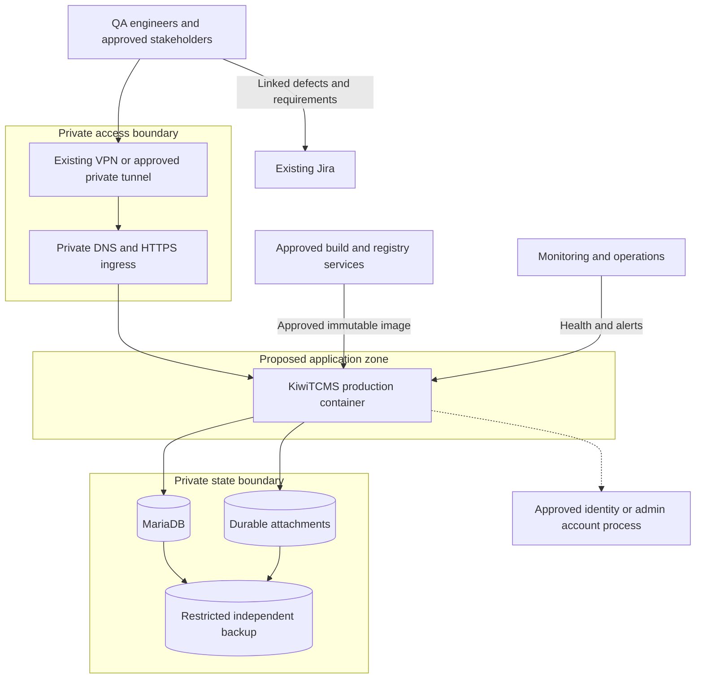

# RFC-002: KiwiTCMS adoption

[Overview](README.md) · [Official references](official-references.md)

**Status: Proposed. Review date: 2026-11-23. Owners: InfraOps for delivery; a nominated QA lead for the workflow.**

## 1. Purpose and approval

Propose KiwiTCMS as a shared, self-managed test platform for approximately 50 daily users, mostly QA engineers.
A working PoC repository will be provided through self-managed GitLab for OpSec experiments.
Production allocation and deployment require explicit OpSec approval.
InfraOps selects the final design within the approved boundaries.

The starting option is a production container, MariaDB and durable attachment storage.
InfraOps selects the production release and build method after approval.

## 2. Problem, benefits and alternatives

QA teams track coverage across spreadsheets, Confluence and Jira, often duplicating records.
Conflicting status creates more coordination, meetings and lost working time.
KiwiTCMS could combine cases, plans, runs, results and evidence in one place.
The pilot must prove the workflow reduces duplicate updates and makes coverage easier to assess.

| Option                     | Benefit                                         | Cost or limitation                                    |
| -------------------------- | ----------------------------------------------- | ----------------------------------------------------- |
| Standardize existing tools | Avoid another application                       | Still needs a shared test model and reporting process |
| KiwiTCMS Community Edition | OSS platform under company control              | Hosting, maintenance and possible customization       |
| KiwiTCMS subscription      | May reduce selected maintenance or feature gaps | Recurring cost; verify included features              |
| TestRail Server            | Commercial self-managed alternative             | Compare licensing, workflow and operating cost        |

TestRail still lists on-premises plans. [Official pricing](https://www.testrail.com/pricing/)

## 3. Workflow and source of truth

Validate these terms against the selected release during the pilot.

| Term           | Meaning                                                                                              |
| -------------- | ---------------------------------------------------------------------------------------------------- |
| Product        | Software area with a QA owner responsible for its test collection                                    |
| Test case      | Reusable steps and expected results                                                                  |
| Test plan      | Collection of cases for an agreed testing purpose                                                    |
| Test run       | Selected cases to execute against a named build and environment                                      |
| Test execution | One case's result, tester and evidence                                                               |
| Test coverage  | Links between requirements/risks and relevant cases/results; case counts alone do not prove coverage |

QA leads own case quality, naming, statuses and revision rules. Testers maintain execution results.
KiwiTCMS becomes the working record for migrated plans and results.
Jira retains defects/work items, Confluence retains general documentation, and GitLab retains source/CI.
Link records instead of maintaining parallel result tables. Set a cutover date for each migrated collection.

## 4. Scope and PoC changes

Include manual case/plan management, runs, result history, attachments, reports and Jira/requirement links.
Defer automated imports, API service accounts and write-capable integrations until separately approved.
Test execution, incident response and release approval remain outside the platform's authority.

The working PoC carries these changes from the source-based trial:

| Required behavior         | Production approach to assess                                                                         |
| ------------------------- | ----------------------------------------------------------------------------------------------------- |
| No ads                    | Reviewed template override/downstream layer, or suitable ad-free image; verify no ad-network requests |
| No external analytics     | Supported opt-out; verify browser/server traffic in production mode                                   |
| No i18n CDN               | Internal language assets; verify supported locales without Internet access                            |
| No registration CAPTCHA   | Controlled account creation with self-registration disabled                                           |
| No activation email       | Approved admin/identity activation; define identity verification and password recovery separately     |
| MariaDB instead of SQLite | Supported persistent MariaDB; verify migrations, concurrent writes and recovery                       |

Retain internal test reports. They are distinct from external usage tracking.
Keep analytics, advertising and translation settings consistent in the production build.
MariaDB matches the upstream Community deployment pattern. Validate the selected release and database version.
[Configuration findings](official-references.md)

## 5. Proposed architecture and network

Use the existing self-managed platform context: GitLab, Jira, Confluence, Proxmox, private VPNs/tunnels, Helm/ArgoCD and Ansible/AWX.
On-premises or VPS capacity may be available. Specific hosting, identity, storage, secrets and backup services remain unconfirmed.

All placements are proposals. The dashed identity path does not assert that Community Edition includes a particular SSO provider.
Attachments need durable storage compatible with KiwiTCMS and its access controls.

| Source → destination                            | Protocol / port                                | Purpose / state                          |
| ----------------------------------------------- | ---------------------------------------------- | ---------------------------------------- |
| User → private ingress                          | HTTPS/TCP 443 through VPN                      | Application access; proposed             |
| Ingress → application                           | Verified TLS; port pending                     | Private proxy path; proposed             |
| Application → MariaDB                           | Database TLS/TCP 3306 proposed                 | Persistent records; proposed             |
| Application → attachment storage                | Protocol/port pending                          | Evidence storage; proposed               |
| User → Jira/Confluence/GitLab                   | HTTPS/TCP 443 proposed                         | Source-system links; proposed            |
| Application → identity service                  | Provider protocol pending                      | Optional sign-in; pending selection      |
| Application → SMTP                              | Internal authenticated TLS; port pending       | Optional notifications/recovery; pending |
| Build/runtime hosts → approved sources/registry | HTTPS/TCP 443 proposed                         | Build and image delivery; proposed       |
| Hosts → DNS/time/log/monitoring/backup services | Existing approved protocols; endpoints pending | Operations and recovery; proposed        |

InfraOps records endpoints, ports, initiators and return routes. Keep application state and management access private.
Deny other runtime traffic by default. Use trusted certificates, hostnames and proxy headers.
Test VPN, DNS, certificate and tunnel failure. Jira links need no server-side API credential.

## 6. Working repository

**Working PoC repository:** _GitLab URL to be added._

A working repository will be provided for OpSec to run experiments and checks.
InfraOps will use the findings when preparing the production design.

## 7. Deployment and operations

### Build and hosting options

Use a production container/server with `DEBUG=False`, explicit allowed hosts and tested TLS, cookie, proxy and CSRF settings.
[Production guidance](https://kiwitcms.readthedocs.io/en/latest/installing_docker.html)

| Build option             | Main trade-off                                                                       |
| ------------------------ | ------------------------------------------------------------------------------------ |
| Upstream Community image | Less downstream maintenance; verify privacy controls and image provenance            |
| Approved source build    | Supports necessary changes; requires reproducibility, review and a maintenance owner |
| Subscribed image/support | Assess feature/support benefits against recurring cost                               |

Prefer supported settings and extensions. Keep necessary source changes small and tied to an approved release.
Pin dependencies and image digests; record component versions. Do not deploy a floating development branch.
The public image is rolling; subscribers can obtain version-tagged images. [Image options](https://kiwitcms.org/containers/)

| Hosting option      | Fit / limitation                                                      |
| ------------------- | --------------------------------------------------------------------- |
| Existing Kubernetes | Reuse Helm/GitOps if cluster, ingress, storage and support exist      |
| Proxmox VM          | Simple deployment under Ansible/AWX; one host can interrupt service   |
| VPS                 | Requires provider approval, private connectivity and reliable tunnels |
| Hybrid              | Reuses internal data services but adds latency and failure paths      |

InfraOps selects the platform, build method and operators.

### Provisional capacity and recovery

Plan for 50 daily users. Test 10–20 active sessions and a 50-session burst, including writes, search and uploads.
These are planning assumptions, not measured capacity or vendor minimums.

| Resource    | Pilot: 5–10 users                 | Starting range: about 50 users                       |
| ----------- | --------------------------------- | ---------------------------------------------------- |
| Application | 1 instance; 1–2 vCPU, 2–4 GiB RAM | 1 instance; 2–4 vCPU, 4–8 GiB; replicas if justified |
| MariaDB     | 1–2 vCPU, 2–4 GiB; 20–40 GiB SSD  | 2–4 vCPU, 4–8 GiB; 50–100 GiB SSD                    |
| Attachments | 10–25 GiB plus separate backup    | 50–200 GiB initially; measure growth and retention   |

Allow additional OS, temporary-file, image and backup capacity. Size attachments from volume and retention, not user count.
Replicas require shared attachments, compatible sessions and migrations. They do not remove database/storage failure.

Continuous availability is intended. InfraOps agrees uptime, maintenance windows, support and recovery targets.
Assess a provisional one-hour data-loss limit and four-hour recovery target for records and attachments together.
Nightly database dumps alone cannot meet that loss limit. InfraOps may revise targets through an explicit cost/risk assessment.

Back up MariaDB, attachments, configuration and required recovery keys outside the runtime's credential/failure domain.
Restore a consistent set into isolation. Verify history, attachments, accounts and access before pilot use.
InfraOps defines retention and the restore-test schedule.

Monitor write/login errors, database locks/connections, disk growth, failed uploads, backup age and certificate expiry.
Test storage/dependency failure without repeated restarts. Stage upgrades and repeat role, privacy and migration checks.
Rollback may require matching database/attachment recovery, not only the previous image.

## 8. Pilot, migration and success measures

Pilot with 5–10 users from at least two QA teams over one representative test cycle.
Validate import/export and field mapping before bulk migration.

1. Map owners, case identifiers, statuses, requirements, Jira links and evidence retention.
2. Import a sample. Verify counts, encoding, duplicates, attachments and history; retain a recovery export.
3. Set the cutover date. Retire the old result tracker or make it read-only.
4. Run real plans, reruns and case revisions. Verify earlier results retain their context.
5. Measure duplicate updates, coordination effort and time needed to find test status.

Candidate success measures:

- Every migrated collection has an owner and one authoritative system for execution results.
- At least 90% of pilot results reach KiwiTCMS without a duplicate status table.
- QA leads find untested scope, failed cases and linked defects without collecting separate spreadsheets.
- Account, permission, privacy, upload, concurrency and recovery checks pass under production settings.
- Ordinary tester/lead accounts complete the workflow. Users can export usable records.

Expand toward 50 daily users after QA accepts the workflow and InfraOps validates readiness.

## 9. Ownership and next steps

InfraOps owns the design, build, operation, upgrades and recovery.
QA leadership owns the test workflow, case review, migration and adoption measures.
NetworkOps and identity/Jira/GitLab operators support InfraOps as needed.
Existing monitoring, observability and AWX/Ansible handle infrastructure incidents.

Next: provide the working repository for OpSec checks. InfraOps then finalizes and validates the production design.
QA leads choose the first collection and agree when duplicate result updates stop.
