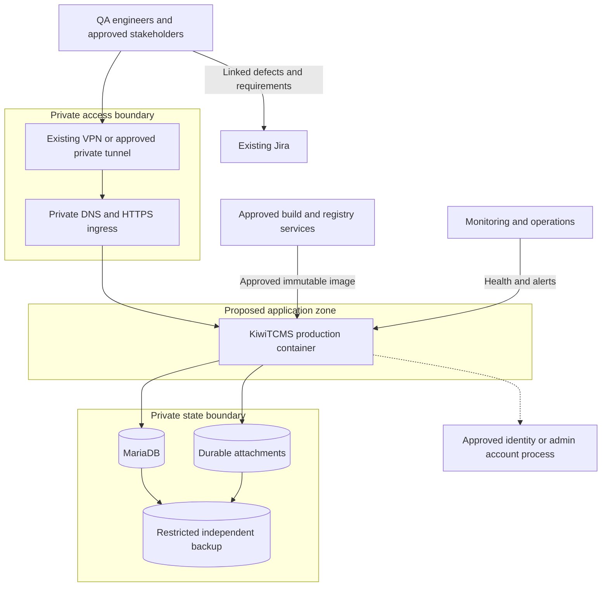

# RFC-002: KiwiTCMS adoption

[Overview](README.md) · [Official references](official-references.md)

**Status: Proposed. Review date: 2026-11-19. Proposed owners: InfraOps for delivery; a nominated QA lead for the workflow.**

## 1. Decision requested

Approve assessment of KiwiTCMS as a shared, self-managed test management platform for approximately 50 daily users, mostly QA engineers.
InfraOps needs explicit OpSec approval before allocating resources or installing the service.
This RFC starts the process; it does not prescribe the final architecture.
InfraOps selects the design and operates within OpSec-approved boundaries. Changes beyond those boundaries require revised approval first.

Proposed basis: a fresh upstream OSS installation, a production container, MariaDB and durable attachment storage.
Select the release, dependencies and build method after approval. No existing development build is the production baseline.

## 2. Problem, benefits and alternatives

QA teams currently track test coverage across spreadsheets, Confluence and Jira, sometimes duplicating the same information.
These separate records create conflicting status, repeated coordination, more meetings and lost working time.
There is no shared test-plan system with consistent ownership and execution records.

KiwiTCMS could provide one place for test cases, plans, runs, results and evidence.
The benefit depends on a shared workflow and migration discipline, not installation alone.
Measure reduced duplicate updates and faster coverage/status checks during the pilot.

| Option                     | Benefit                                              | Cost or limitation                                                   |
| -------------------------- | ---------------------------------------------------- | -------------------------------------------------------------------- |
| Standardize existing tools | Avoid another application                            | Still needs one agreed test model, ownership and reporting process   |
| KiwiTCMS Community Edition | OSS test management under company control            | Requires hosting, patching, access review and possible customization |
| KiwiTCMS subscription      | May reduce image, support or integration maintenance | Adds recurring cost; verify required features and terms              |
| TestRail Server            | Commercial self-managed alternative                  | Compare licensing, workflow fit and operating cost                   |

TestRail currently lists on-premises Server plans. It remains a commercial alternative for the evaluation.
[Official TestRail pricing](https://www.testrail.com/pricing/)

## 3. Workflow and source of truth

These terms describe the proposed workflow. Validate their mapping to the selected KiwiTCMS release during the pilot.

| Term           | Meaning                                                                                                      |
| -------------- | ------------------------------------------------------------------------------------------------------------ |
| Product        | The software area whose QA owner maintains the test collection                                               |
| Test case      | A reusable test description with steps and expected results                                                  |
| Test plan      | A maintained collection of cases for an agreed testing purpose                                               |
| Test run       | A planned execution of selected cases against a named build and environment                                  |
| Test execution | One case's execution record, including status, tester and supporting evidence                                |
| Test coverage  | The link between agreed requirements/risks and relevant cases/results; a count alone does not prove coverage |

QA leads own product structure, case quality, naming and status definitions.
Testers maintain execution results. Engineering/product stakeholders use agreed reports.
Define how case revisions, reruns and obsolete cases affect historical results before migration.

KiwiTCMS becomes the working record for migrated test plans and results.
Jira remains the defect/work tracker. Confluence retains general documentation. GitLab remains the source and CI system.
Link these records rather than maintain parallel result tables.
During migration, identify the authoritative record and cutover date for each imported collection.

## 4. Scope and reported trial changes

Include manual test management, reusable cases, plans, runs, result history, attachments and links to Jira/requirements.
Evaluate reports against real coverage questions. Daily use includes concurrent writes, not only reading published information.

Defer automated result imports, API service accounts, Jira ticket creation and other write-capable integrations until separately approved.
KiwiTCMS is not a test runner, production monitoring service, incident orchestrator or automatic release-approval authority.

The requester reports a separate source-based trial with the changes below. It ran in development mode.
These are desired behaviors to assess, not verified production settings or permission to transfer that implementation.

| Requested behavior              | Proposed production approach                                                         | Required check                                                    |
| ------------------------------- | ------------------------------------------------------------------------------------ | ----------------------------------------------------------------- |
| No ads                          | Use a reviewed template override/downstream layer, or assess an ad-free image option | No ad scripts, frames or ad-network requests                      |
| No external telemetry/analytics | Use supported opt-out settings; retain internal test reports                         | Inspect browser and server traffic in production mode             |
| No i18n CDN                     | Serve required language assets internally; remove external translation-script paths  | Test default and alternate locales without Internet access        |
| No registration CAPTCHA         | Prefer controlled account creation with self-registration disabled                   | No anonymous account creation or unintended registration endpoint |
| No email activation links       | Activate accounts through an approved admin/identity process                         | Verify identity without trusting an unverified email address      |
| MariaDB instead of SQLite       | Use a supported persistent MariaDB version                                           | Test migrations, concurrent writes, backup and restore            |

MariaDB matches the upstream Community deployment pattern; the selected version still needs compatibility and recovery tests.
External tracking is distinct from internal test reporting. Removing internal reporting would weaken the proposed benefit.
Current upstream analytics behavior differs between development and production. A successful development run does not prove the required privacy controls.
Advertising, analytics and translation assets need separate checks. [Configuration findings](official-references.md)

## 5. Proposed architecture and network

Organization context: self-managed GitLab, Jira and Confluence; Proxmox; on-premises/VPS capacity; private VPNs/tunnels; Helm, ArgoCD and Ansible/AWX.
No suitable cluster, database service, registry, identity provider, ingress, secret service or backup platform is assumed available.

All placements are proposals. A dashed identity connection does not assert that stock Community Edition includes a particular SSO provider.
Attachments are application data, not Backstage TechDocs. Storage must support KiwiTCMS's selected backend and access checks.

| Source → destination                                    | Protocol / port                                | Purpose                                                               | State            |
| ------------------------------------------------------- | ---------------------------------------------- | --------------------------------------------------------------------- | ---------------- |
| User → private ingress                                  | HTTPS/TCP 443 proposed, through existing VPN   | Application access                                                    | Proposed         |
| Ingress → application                                   | Verified TLS; application port pending         | Private proxy path                                                    | Proposed         |
| Application → MariaDB                                   | Database TLS/TCP 3306 proposed                 | Test records and application state                                    | Proposed         |
| Application → attachment storage                        | Selected filesystem/storage protocol; pending  | Private evidence storage                                              | Proposed         |
| User → Jira/Confluence/GitLab                           | HTTPS/TCP 443 proposed                         | Links under source-system access                                      | Proposed         |
| Application → identity service                          | Provider protocol; pending selection           | Optional approved sign-in                                             | Proposed         |
| Application → SMTP                                      | Internal authenticated TLS; port pending       | Optional notifications/password recovery, not registration activation | Decision Pending |
| Build/runtime hosts → approved sources/registry         | HTTPS/TCP 443 proposed                         | Build dependencies and image delivery                                 | Proposed         |
| Service hosts → DNS/time/log/monitoring/backup services | Existing approved protocols; endpoints pending | Operation and recovery                                                | Proposed         |

InfraOps records actual endpoints, ports, directions and return routes for the chosen design.
Deny other runtime egress by default. Keep the database, attachments and management endpoints private.
Use trusted certificates, exact hostnames and trusted proxy headers. Test VPN, DNS, certificate and tunnel failure.
Jira API access needs another approved flow; simple links do not require a server-side Jira token.

## 6. Privacy, identity and permissions

### Accounts and roles

Preferred starting point: administrator-created accounts, with self-registration disabled.
Disabling CAPTCHA and email activation does not authorize open registration or automatic admission.
Define password delivery/reset, account removal and emergency administrator access.
Email notifications and password recovery are separate decisions from registration activation.

Evaluate existing corporate identity options. Do not assume GitLab OAuth, LDAP or another SSO provider is included in the chosen edition.
Assess required add-ons, maintenance and subscription costs before selecting identity integration.

| Role                                       | Intended rights                                                                           |
| ------------------------------------------ | ----------------------------------------------------------------------------------------- |
| InfraOps and designated support admins     | Deployment, accounts, security configuration and controlled global administration         |
| QA/domain lead                             | Maintain assigned product plans, cases and agreed reports; no global privilege by default |
| Tester                                     | Maintain approved cases and record assigned execution results                             |
| Stakeholder                                | Read permitted plans, results and reports                                                 |
| Import/service identity, if later approved | Only the operations required for its integration                                          |

Use custom groups and test actual rights after upgrades. The default Tester group's permissions can be reset by upgrade commands.
KiwiTCMS staff status is distinct from superuser status and can be needed for ordinary application functions.
Do not infer privilege from that flag alone.

Upstream documents limitations in object-level permissions, including the API layer.
Prove the required UI and API boundaries; do not promise team isolation from product ownership or hidden buttons.
If required isolation cannot be enforced, OpSec must accept another scope or the platform must not launch with that data.
Keep global administration central if delegated boundaries are impractical.
Disable departing accounts rather than delete users linked to historical records. [Permission guidance](official-references.md)

### Data, credentials and threats

Plans and results can reveal architecture, vulnerabilities, release readiness and personal information.
Attachments may contain credentials or customer data. Define permitted test data, retention, upload limits and deletion rules.
Avoid real customer data and secrets unless a separate approved process requires them.
Test direct attachment URLs with signed-out and unauthorized accounts.
Internal readership remains subject to OpSec policy; Backstage's catalog permissions do not apply to this application.

| Credential                       | Scope and storage                                                         | Owner / lifecycle                                   | Effect of theft                          |
| -------------------------------- | ------------------------------------------------------------------------- | --------------------------------------------------- | ---------------------------------------- |
| Application secret               | Runtime secret store; unique to this installation                         | InfraOps; rotate with session/recovery tests        | Session or application compromise        |
| Database account                 | Application database only; no server administration; runtime secret store | Database operator; replace with pool/restart tests  | Test records and stored secrets exposed  |
| Registry identities              | Separate approved build push and runtime pull                             | InfraOps; expiry/replacement under existing policy  | Malicious image or image disclosure      |
| Identity/SMTP secrets, if needed | Minimum scopes; approved secret store                                     | Identity/mail owner; revoke/replace and test        | Account or mail misuse                   |
| Backup credentials/keys          | Independent backup rights and key custody                                 | InfraOps; rotation must preserve restore capability | Bulk disclosure or unrecoverable records |

| Risk                                        | Priority    | Required control                                                            | Owner / remaining risk                                 |
| ------------------------------------------- | ----------- | --------------------------------------------------------------------------- | ------------------------------------------------------ |
| Unintended registration or excessive rights | High        | Controlled accounts; custom roles; UI/API denial tests                      | InfraOps/OpSec; residual policy defects                |
| External tracking or CDN dependency returns | High        | Production-mode traffic tests, reviewed overrides and restricted egress     | InfraOps; updates can reintroduce calls                |
| Evidence or test history lost/changed       | High        | Least privilege, history checks and consistent database/attachment recovery | InfraOps/QA leads; authorized mistakes remain possible |
| Source changes create an unsupported fork   | High        | Small reviewed change set, release owner and upgrade tests                  | InfraOps; recurring maintenance cost                   |
| Sensitive attachment exposed                | High        | Authorized downloads, size/type controls and approved data handling         | InfraOps/OpSec; downloads create further copies        |
| Daily workflow blocked by outage            | Medium–High | Agreed service tier, monitoring and tested recovery                         | InfraOps; single-instance pilot can interrupt work     |

Record security-relevant changes, sign-in failures, account/role changes and administrative actions.
Validate available history and audit coverage; case revision history alone is not a complete security audit.

## 7. Deployment and operations

### Build and hosting options

Upstream production guidance uses containers. A source build must still produce a controlled production image.
Use a production server, `DEBUG=False`, explicit allowed hosts, secure cookies and tested proxy/CSRF settings.
Development-server behavior is not the acceptance target. [Production guidance](https://kiwitcms.readthedocs.io/en/latest/installing_docker.html)

| Build option                                 | Benefit                                                      | Required assessment                                                                 |
| -------------------------------------------- | ------------------------------------------------------------ | ----------------------------------------------------------------------------------- |
| Upstream Community image                     | Smaller downstream maintenance burden                        | Rolling-image provenance, immutable digest and ability to meet privacy requirements |
| Approved source build with minimal overrides | Supports required changes when configuration is insufficient | Release/source pinning, reproducibility, scan results and patch ownership           |
| Subscribed image/support                     | Can reduce selected maintenance or feature gaps              | Exact features, licenses, cost and continued self-management                        |

Prefer supported settings and documented extensions over edits to application logic.
If source changes remain necessary, keep them small, reviewed and tied to an approved upstream release.
Do not deploy a floating development branch. Mirror approved artifacts by immutable digest.
Record app, database, runtime, add-on and build-tool versions after permission.
The public image is rolling; upstream reserves version-tagged images for subscribers. [Image options](https://kiwitcms.org/containers/)

| Hosting option      | Fit                                                                         | Cost or availability concern                                   |
| ------------------- | --------------------------------------------------------------------------- | -------------------------------------------------------------- |
| Existing Kubernetes | Reuse supported Helm/GitOps, private ingress and data services if available | Cluster, storage and operating support must be confirmed       |
| Proxmox VM          | Simple app/database placement under existing Ansible/AWX practices          | One host can interrupt the whole service                       |
| VPS                 | Additional capacity if internal hosting is unsuitable                       | Provider approval, tunnel reliability and private state access |
| Hybrid              | Reuses internal data services                                               | Adds latency and network failure paths for frequent writes     |

Prefer existing supported internal infrastructure. InfraOps selects the actual design and names its operators.

### Provisional capacity and recovery

Plan for 50 daily users, not 50 permanently concurrent sessions.
Test 10–20 active sessions and a 50-session burst with realistic result writes, search and attachment uploads.
These are planning assumptions, not measured capacity or vendor minimums.

| Resource    | Small pilot: 5–10 users           | Full-use starting range: about 50 users                             |
| ----------- | --------------------------------- | ------------------------------------------------------------------- |
| Application | 1 instance; 1–2 vCPU, 2–4 GiB RAM | 1 instance initially; 2–4 vCPU, 4–8 GiB; replicas only if justified |
| MariaDB     | 1–2 vCPU, 2–4 GiB; 20–40 GiB SSD  | 2–4 vCPU, 4–8 GiB; 50–100 GiB SSD                                   |
| Attachments | 10–25 GiB plus separate backup    | 50–200 GiB initial allocation; measure growth and retention         |

Allow additional OS, proxy, temporary-file, image, backup and redundancy capacity.
Estimate attachments from daily evidence volume, retention and replication; user count alone cannot size them.
Replica deployment requires compatible sessions, shared attachments, database access and tested migrations.
Two web replicas do not remove database or storage failure.

Continuous availability is intended. InfraOps agrees actual uptime, maintenance windows, recovery targets and support coverage.
For daily operational records, assess a provisional one-hour maximum data-loss window and four-hour recovery target.
These apply to database records and attachments together; nightly database dumps alone cannot meet that loss target.
InfraOps may revise them with an explicit cost/risk decision.

Back up MariaDB, attachments, deployment configuration and required secret/key recovery material.
Keep encrypted backups independent of runtime credentials and failure domains.
Restore a consistent database/attachment set into isolation; check execution history, file links, account state and access controls.
Test recovery before pilot access. Agree retention and repeat-drill frequency with InfraOps and OpSec.

Monitor write latency/errors, login failures, database locks/connections, disk growth, failed uploads, backup age and certificate expiry.
Test health probes, dependency outages and storage exhaustion without restart storms.
Stage upgrades and review migrations. Reapply configuration/role/privacy checks before promotion.
Rollback may require a matching database and attachment restore, not only the previous image.

## 8. Pilot, migration and success measures

Proposed pilot: 5–10 users from at least two QA teams over one representative release/test cycle.
Choose a small, owned test collection. Import/export capabilities and field mapping need validation before bulk migration.

1. Map products, owners, case identifiers, statuses, requirements, Jira links and evidence retention.
2. Import a sample; verify counts, encoding, duplicates, attachments and historical meaning. Retain a recovery export.
3. Mark each collection's cutover date. Make the old execution tracker read-only or clearly retired.
4. Complete real plans, runs, reruns and case revisions. Verify earlier results retain their context.
5. Compare coordination effort and status-finding time with the current process.

Candidate acceptance measures:

- Every migrated collection has an owner and one authoritative execution record.
- At least 90% of pilot execution results are recorded in KiwiTCMS without a duplicate status table.
- QA leads can identify untested scope, failed cases and linked defects without collecting separate spreadsheets.
- Coverage is based on agreed mappings, not a claimed percentage from case counts alone.
- Account, permission, privacy, upload, restore and representative concurrency tests pass under production settings.
- Ordinary tester and lead accounts pass the workflow tests; the bootstrap administrator is not the only test account.
- Users can export usable records. Upgrade maintenance and ongoing support have named owners.

Expand toward 50 daily users only after QA accepts the workflow and InfraOps validates operational readiness within OpSec boundaries.

## 9. Ownership and review questions

InfraOps owns the final design, production build, runtime, state, upgrades, monitoring and recovery.
QA leadership owns taxonomy, test process, case review, migration and adoption measures.
OpSec sets identity, readership, privilege, privacy and retention boundaries.
NetworkOps, identity administrators and Jira/GitLab operators support InfraOps as needed.

**OpSec:** Are controlled accounts and the selected role/API model acceptable? Which test data and external requests are permitted?
**InfraOps:** Which hosting/build path meets privacy requirements? Who supports customization, MariaDB, attachment recovery and daily availability?
**QA leads:** Which workflow and collection move first? When do duplicate trackers stop accepting result updates?

## 10. Decisions and next steps

All rows are Proposed. This record does not assert OpSec approval or an installed service.

| ID   | Choice                                                          | Owner                    | Evidence needed                                                     |
| ---- | --------------------------------------------------------------- | ------------------------ | ------------------------------------------------------------------- |
| K-01 | Community OSS candidate / subscription / commercial alternative | Sponsor, QA and InfraOps | Workflow fit, ownership and total operating cost                    |
| K-02 | Upstream image / approved source build with minimal overrides   | InfraOps                 | Reproducibility, privacy checks and maintenance owner               |
| K-03 | Controlled accounts / approved identity integration             | OpSec, InfraOps          | Registration, recovery, offboarding, roles and API tests            |
| K-04 | MariaDB, durable attachments and hosting topology               | InfraOps                 | Compatible release, sizing, persistence and restore                 |
| K-05 | No ads/tracking/CDN, with internal reporting retained           | OpSec, InfraOps          | Browser/server tests in production mode and blocked-egress behavior |
| K-06 | Shared test workflow and migration cutover                      | QA leadership            | Pilot results, source-of-truth rules and usable export              |

Next: request OpSec assessment, record boundaries, then let InfraOps select and validate the installation.
Use [Official references](official-references.md) when checking the release selected after permission.
