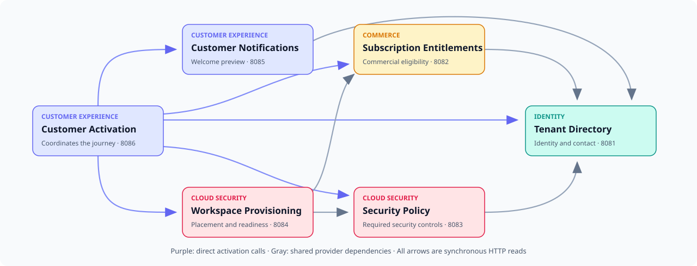
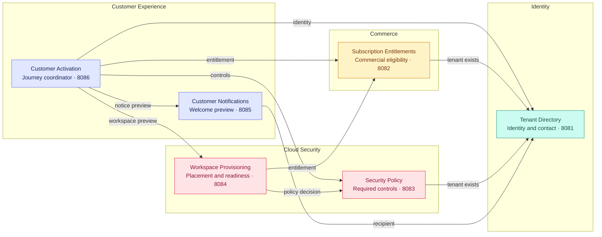

# Six services. Ten dependency links.

## Read the map

Customer Activation calls all five providers. Workspace Provisioning needs both security policy and commercial entitlement. Policy, Subscription, and Notifications each share Tenant Directory. These extra reads deliberately model the coordination cost: a change in Identity can affect every team.

Arrows indicate caller → provider, not ownership transfer or event flow. Each catalog `dependsOn` link corresponds to an actual HTTP call. `providesApis` and `consumesApis` describe the same boundary as a discoverable contract.

There is no runtime cycle. The organizational entanglement comes from shared providers and a journey that crosses four teams. Backstage makes that existing structure visible; it does not simplify it automatically.

## Mermaid source

The SVG above is an offline illustration of this diagram. The Mermaid source is also in `docs/handbook/architecture.mmd` in the onboarding repository.

## Intentional overlap, resolved

- “Active tenant” is split into verified identity, active commercial entitlement, allowed security policy, and workspace readiness.
- Customer Experience owns journey coordination; it cannot change Commerce or Cloud Security decisions.
- Tenant Directory is the authoritative contact source; Notifications does not keep a separate customer spreadsheet.
- Provisioning reads both prerequisite decisions and never guesses that a successful identity lookup implies authorization.

The read-only fixtures make these boundaries explicit. A real activation would also need idempotency, durable state, compensation, and a delivery mechanism for notices.
